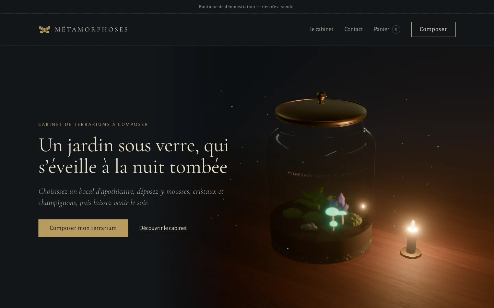
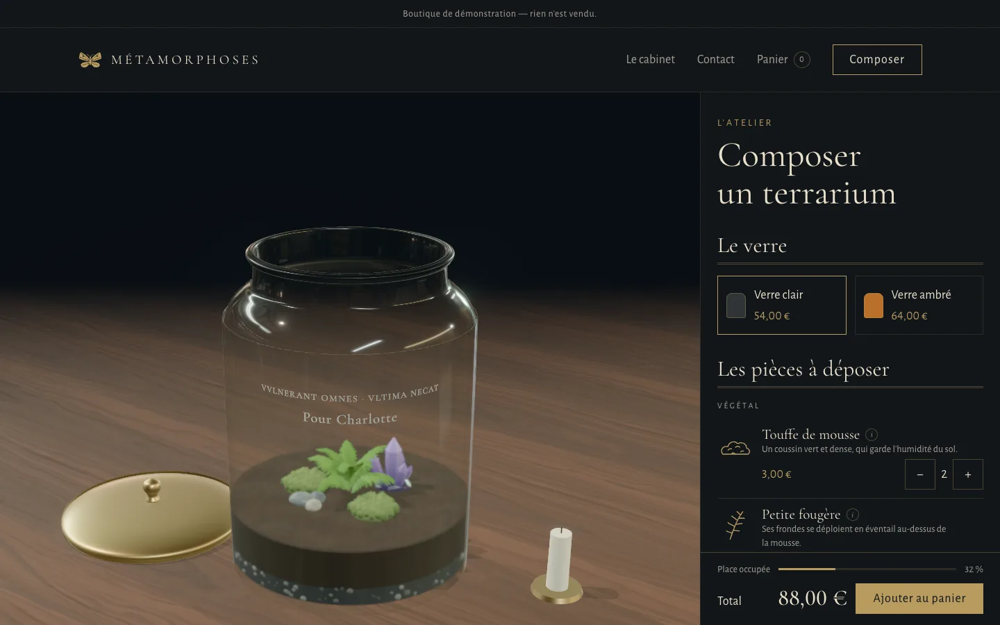
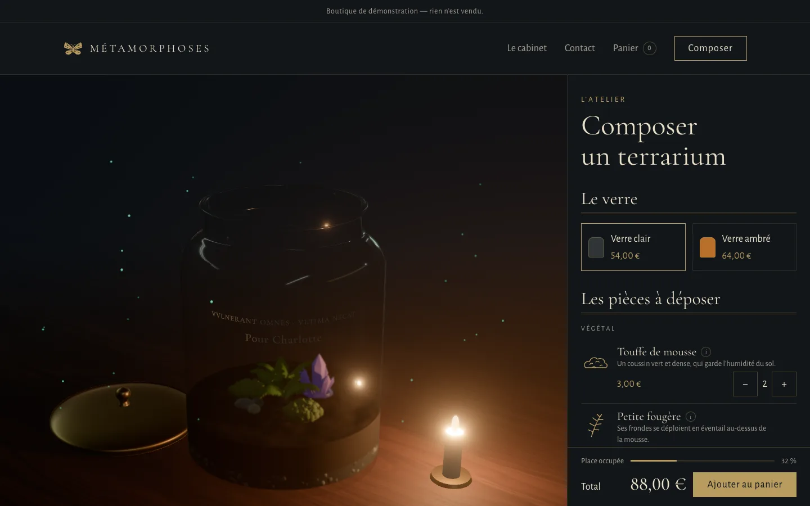
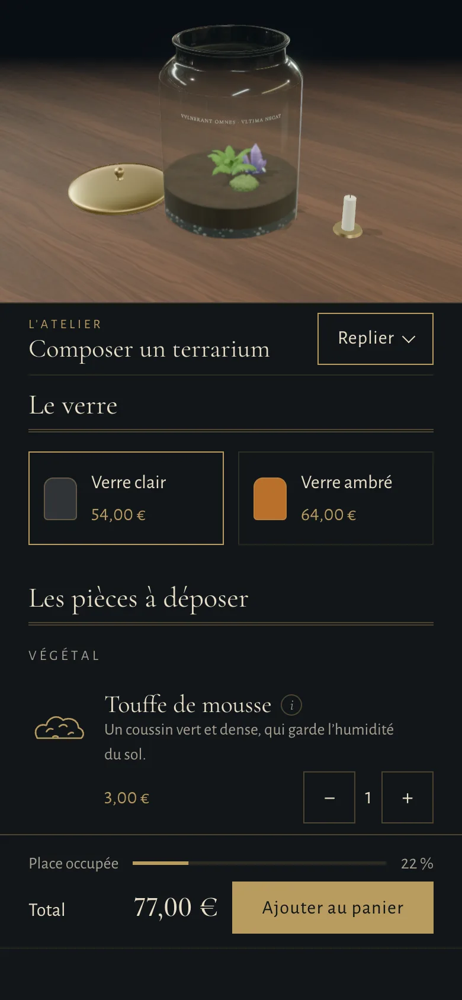
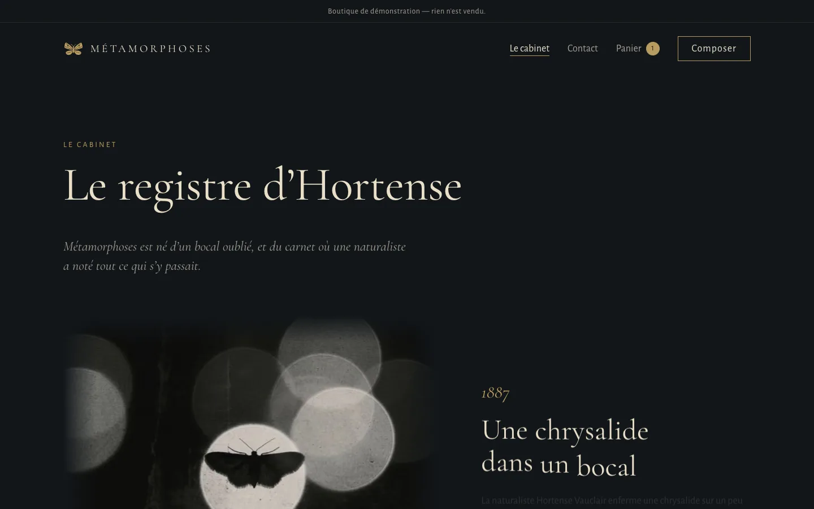
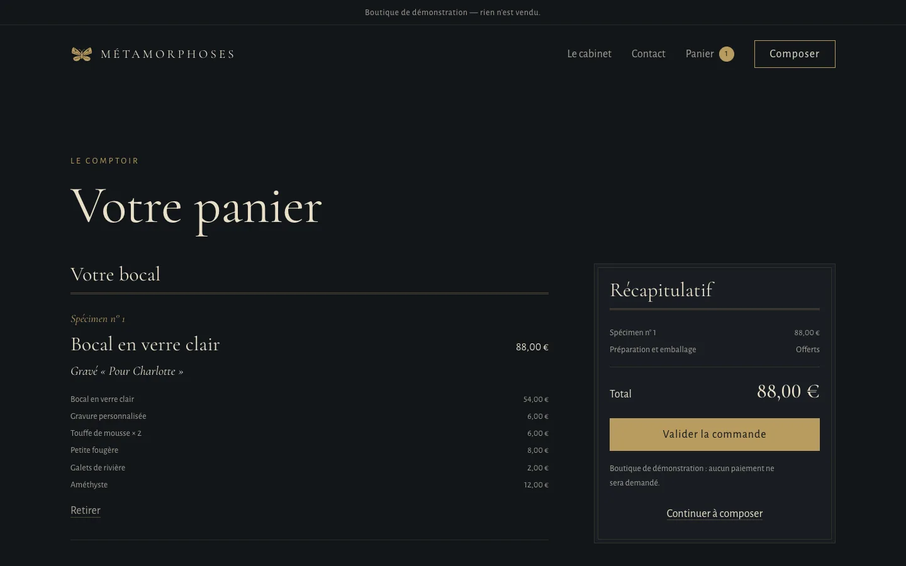

# Métamorphoses

**Cabinet de terrariums à composer en 3D.** Une boutique imaginaire : on choisit un bocal d'apothicaire, on y dépose mousses, fougère, galets, améthyste et champignons, on grave quelques mots dans le verre, puis on attend la nuit. La bougie s'allume, les lucioles se lèvent, les champignons se mettent à luire.

**[Voir le site → metamorphoses-shop.vercel.app](https://metamorphoses-shop.vercel.app/)**

> Boutique de démonstration : rien n'est vendu, aucun paiement n'est demandé.
> Projet de la section « Lab » du [portfolio de Laura Dimitroff](https://laura-dimitroff.vercel.app/).



---

## Le parcours

### L'atelier

On compose à la main : chaque pièce se dépose dans le bocal, se fait glisser sur la terre, tourne par pas de 15°. Une jauge indique la place qui reste, le prix se calcule en direct, et un bouton fait passer la scène du jour à la nuit.

| De jour | À la nuit tombée |
|---|---|
|  |  |



**Sur téléphone**, le panneau devient un tiroir. Ouvert, il repousse la scène vers le haut sans la masquer : on voit la pièce se poser au moment où on la choisit. Replié, il garde à portée la jauge, le total et l'ajout au panier.

**Au clavier**, tout est possible sans souris : flèches pour déplacer une pièce, R pour la tourner, Suppr pour la retirer. Une description textuelle de la scène, mise à jour à chaque changement, est lue par les lecteurs d'écran.

<br clear="right" />

### Les autres pages

- **Le cabinet** : le registre d'Hortense Vauclair, naturaliste fictive, en quatre chapitres illustrés.
- **Le panier** : chaque bocal détaillé, un récapitulatif, et une commande « consignée au registre », sans paiement.
- **Contact** : un formulaire accessible, avec un message d'erreur précis sous chaque champ.
- **Le registre des crédits** (`/credits`) : l'auteur, la source et la licence de chaque fichier tiers.

| Le cabinet | Le panier |
|---|---|
|  |  |

---

## Sous le capot

| | |
|---|---|
| Interface | React 19, TypeScript strict, Vite, React Router, Zustand, CSS Modules |
| 3D | Three.js, React Three Fiber, drei, postprocessing (halo, mappage des tons AgX, grain) |
| Qualité | Vitest (60 tests), Playwright (23 tests de bout en bout), oxlint, intégration continue GitHub Actions |
| Hébergement | Vercel |

Quelques choix qui ont demandé de la réflexion, chacun documenté dans le [journal de décisions](docs/decisions.md) :

- **Le verre** est rendu par transmission (`MeshPhysicalMaterial`) : il réfracte et reflète réellement la scène, ce qui a imposé quelques contorsions pour que la terre lumineuse et la fougère restent visibles au travers.
- **Le placement** suit une spirale de Vogel pour trouver une place libre, avec deux rayons par pièce : un pour l'encombrement au sol, un pour la distance au verre ([D12](docs/decisions.md)). La jauge n'affiche « plein » que si plus rien ne rentre ([D13](docs/decisions.md)).
- **Les prix** sont des centimes entiers, les positions des millièmes d'unité : aucun arrondi flottant ne s'invite dans un total.
- **Le jour et la nuit** sont une seule valeur animée, que lisent la lumière, la bougie, les champignons et les lucioles.
- **L'accessibilité** vise le niveau AA des WCAG 2.2 : contrastes, focus visible, cibles de 44 px, parcours complet au clavier, `prefers-reduced-motion` respecté. Sans WebGL, l'atelier reste utilisable.

### Performance

- Les fichiers 3D (HDRI, textures, modèle) pèsent **348 Ko**, contre 3,1 Mo au départ : l'HDRI est encodée en JPEG Ultra HDR, les textures en WebP ([D15](docs/decisions.md)).
- Three.js n'est chargé que par l'accueil et l'atelier ; les autres pages s'ouvrent sans lui.
- La scène est préchargée dès qu'on survole un lien « Composer », et sa résolution baisse si l'appareil peine ([D16](docs/decisions.md)).
- Sur une 4G rapide simulée, l'atelier s'affiche en **1,8 s** en arrivée directe, en **1,3 s** depuis une autre page.

### Organisation du code

```
src/
├─ domaine/    règles pures et testées : prix, encombrement, description, gravure, panier
├─ catalogue/  les données : le bocal, les cinq pièces
├─ etat/       magasins Zustand : composition, interface, panier
├─ scene/      tout ce qui est 3D : la vitrine, le bocal, les pièces et leurs générateurs
├─ interface/  composants communs : en-tête, atelier, panier
└─ pages/      une page par route, chargée à la demande
```

Le domaine ne connaît ni React ni Three.js : c'est lui que testent les tests unitaires. Le détail est dans le [document d'architecture](docs/architecture.md).

---

## Lancer le projet

Il faut Node 24 (fixé dans `.nvmrc`).

```bash
nvm use
npm install
npm run dev
```

Le site s'ouvre sur http://localhost:5173.

| Commande | Rôle |
|---|---|
| `npm run dev` | serveur de développement |
| `npm run build` | vérification des types, puis construction dans `dist/` |
| `npm run preview` | sert la version construite |
| `npm run lint` · `npm run typecheck` | analyse du code, vérification des types |
| `npm test` · `npm run test:e2e` | tests unitaires · tests de bout en bout |
| `npm run credits` | régénère `CREDITS.md` à partir du registre |

Les scripts de `scripts/` préparent les ressources et mesurent le site : retraitement des photos, compression des textures, encodage de l'HDRI, captures de ce README, mesure du chargement en 4G simulée. Chacun explique en tête de fichier comment le lancer.

---

## Crédits

Le modèle de fougère vient de Poly Pizza, l'HDRI et la texture de noyer de Poly Haven, les photographies d'Unsplash ; les polices et les bibliothèques sont libres. Tout est recensé, avec auteur et licence, dans [`CREDITS.md`](CREDITS.md) et sur la page `/credits` du site. Un test vérifie qu'aucun fichier n'est publié sans y figurer.

## Documentation

- [Cahier des charges](docs/cahier-des-charges.md) : le périmètre et les objectifs.
- [Architecture](docs/architecture.md) : l'organisation du code et le plan des étapes.
- [Journal de décisions](docs/decisions.md) : D1 à D16, chaque choix avec son contexte et ce qu'on a écarté.
- [Repérage](docs/reperage.md) : la recherche des modèles et des ressources.
